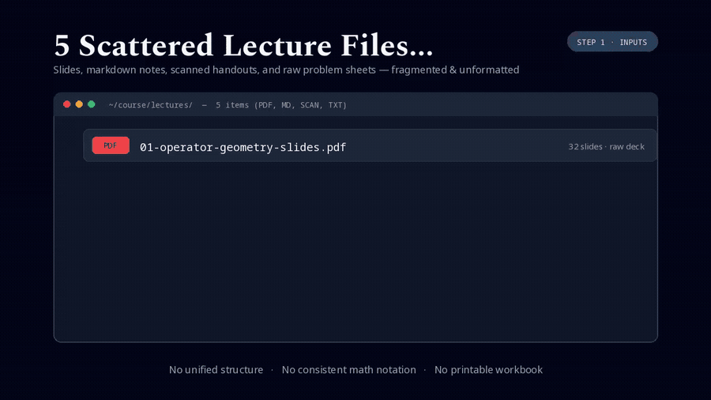
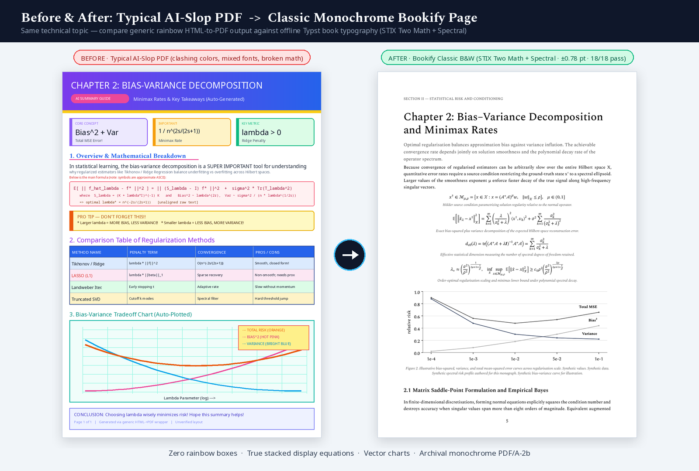

# Bookify

**An AI-agent skill for authoring publication-grade PDF books, scholarly math monographs, and practice workbooks — compiled offline with Typst and verified across 18 automated checks.**

Works out of the box with **Claude Code**, **OpenAI Codex**, **OpenCode**, **Cursor**, and **Google Antigravity** on **Linux, macOS, and Windows**.

<p align="center">
  <a href="docs/previews/bookify-demo.mp4">
    
  </a>
  <br />
  <sub>20-second demo (<a href="docs/previews/bookify-demo.mp4">watch HD MP4</a>) — 5 scattered lecture files → 1 command → 1 verified publication-grade book &amp; workbook.</sub>
</p>

## Before & After: AI-Slop PDF vs. Classic Bookify Page

<p align="center">
  
  <br />
  <sub>Same Bias–Variance technical content: replace clashing gradient banners, random font sizes, and loud striped tables with quiet archival monochrome typography.</sub>
</p>

## Output Showcase

| Scholarly Math Monograph (`STIX Two Math` + `Spectral`) | Human Error-Recovery Practice Workbook |
| :---: | :---: |
|  |  |
| *27 display equations, stacked limits, KKT matrices, bias–variance chart & tables — all 33 captions centred within ±0.78 pt.* | *24 pt handwriting dotted lines, dot-grid proof pads, padded fill-in tables with +2 overflow rows & coordinate axes.* |

---

## Why Bookify?

Hand your AI coding agent a PDF, slide deck, or research notes and ask for a finished book. Instead of dumping unstyled Markdown into a generic HTML-to-PDF wrapper, the **`92 KB` Bookify skill** gives your agent:

- **Agent-owned editorial & visual judgement:** Two explicit authoring modes — `source-faithful` (strict source fidelity and provenance, zero outside material) and `teachable` (standalone textbook voice with worked examples, definitions, practice exercises, and glossaries).
- **Publication typography & display mathematics:** Vendored `Spectral` (7 weights) + `STIX Two Math` (stacked display limits, matrices, integrals, piecewise `cases(...)`) + optional on-demand `Noto Serif CJK JP`, compiled to archival **PDF/A-2b**.
- **Mathematically centered layouts (`±2 pt`):** Every display equation, description/caption, table, chart, diagram, and illustration centres cleanly to its page or column measure and is verified automatically.
- **Human error-recovery exercise workspaces:** Native Typst primitives (`responseSpace` + `fillSpace`/`extraRows`) and a 10-case editorial rule ensure practice sections leave realistic room for handwriting, crossing out false starts, and revising work (dotted lines, dot-grid proof pads, padded fill-in tables with overflow rows, coordinate grids, multiple-choice revision lines, and algorithm trace tables).
- **Rich visual primitives:** 7 monochrome covers (`cover-1`–`cover-7`), 4 body compositions (`full`, `centred`, `side-left`, `side-right`), two-column chapters, 15 deterministic chart families, 10 CeTZ diagram presets, depth-5 hierarchical numbering (`§` cross-references), and optional intake-only Tesseract OCR.
- **Closed-loop visual verification:** The skill instructs your agent to render a contact sheet (pure-Python Pillow — no ImageMagick), visually inspect every page, fix layout/label defects, and pass **18 automated checks** (offline determinism, glyph coverage, caption centering, heading rhythm, readability, and provenance) before handing you the final PDF.

---

## Install Bookify

Bookify pairs a **`92 KB` portable skill** ([`skills/bookify/`](skills/bookify/SKILL.md)) with a **`2.0 MB` offline Typst CLI engine** distributed via GitHub Releases.

### Option A — Let Your AI Agent Install It (Recommended)

Paste this prompt into **Claude Code, OpenAI Codex, OpenCode, Cursor, or Google Antigravity**:

```text
Install the Bookify AI-agent skill and offline CLI engine (https://github.com/trisnwyn/Bookify) for my OS and harness:

1. Check my OS and verify Python 3.12–3.13, `uv` (or `pipx`), and Poppler (`pdfinfo`, `pdftoppm`).
   - If Poppler is missing, show me the exact one-line install command for my OS (`brew install poppler`, `sudo apt install poppler-utils`, `sudo dnf install poppler-utils`, or `winget install oschwartz10612.Poppler`).
2. Install the pre-built 2 MB Bookify CLI wheel from the latest GitHub Release (do not install from PyPI and do not clone the full repo):
   - Linux / macOS: `curl -fsSL https://raw.githubusercontent.com/trisnwyn/Bookify/main/install.sh | sh`
   - Windows (PowerShell): `irm https://raw.githubusercontent.com/trisnwyn/Bookify/main/install.ps1 | iex`
3. Verify the CLI and pinned Typst 0.15.1 binary:
   - `bookify --version`
   - `bookify toolchain install --json`
4. Install the portable Bookify skill for my agent platform:
   - `bookify skill install --platform all --json` (or target my active platform: `claude`, `codex`, `opencode`, `cursor`, or `antigravity`).
5. Run `bookify toolchain doctor --json` and confirm `"ok": true`.
   - Only run `bookify fonts install cjk` if I request Japanese/CJK book support.
6. Report the installed version, skill path, and doctor status concisely.
```

### Option B — Manual 2-Step Install (Humans)

#### Prerequisites
- **Python 3.12 or 3.13** and **`uv`** *(recommended)* or `pipx`
- **Poppler** *(required for `bookify verify` and page rendering)*:
  - **macOS:** `brew install poppler`
  - **Ubuntu / Debian:** `sudo apt install poppler-utils` *(optional Linux strict sandbox: `bubblewrap`)*
  - **Fedora:** `sudo dnf install poppler-utils` *(optional: `bubblewrap`)*
  - **Windows:** `winget install oschwartz10612.Poppler` *(or `choco install poppler`)*
- *(Optional, OCR intake only)* **Tesseract** (`tesseract` + `eng` language pack; build and verify never need OCR).

#### Step 1 — Install the Skill

```bash
# Universal Agent Skills CLI (Claude Code, Codex, Cursor, OpenCode, Antigravity, Copilot)
npx skills add trisnwyn/Bookify

# Or Claude Code Plugin Marketplace:
# /plugin marketplace add trisnwyn/Bookify
```

#### Step 2 — Install the 2.0 MB Offline Typst Engine

```bash
# Linux / macOS (installs wheel + pinned Typst 0.15.1)
curl -fsSL https://raw.githubusercontent.com/trisnwyn/Bookify/main/install.sh | sh
```

```powershell
# Windows PowerShell (installs wheel + pinned Typst 0.15.1)
irm https://raw.githubusercontent.com/trisnwyn/Bookify/main/install.ps1 | iex
```

*(You can also install or sync the skill across all 5 harnesses via the CLI at any time:)*

```bash
bookify skill install --platform all       # claude, codex, opencode, cursor, antigravity
bookify toolchain doctor --json            # verify Typst, fonts, packages, and Poppler
bookify fonts install cjk                  # optional: only needed for Japanese/CJK books
```

---

## Using the Skill in Your Agent

Once installed, invoke a slash command (in Claude Code / OpenCode) or describe what you want in natural language (in Antigravity, Codex, Cursor, etc.):

| Command / Prompt Mode | Behaviour |
| --- | --- |
| `/bookify` *(default)* | **`source-faithful`** — turns your attached PDF/slides into a cleanly typeset book in original order with zero invented material. |
| `/bookify-source-faithful` | Explicit **`source-faithful`** entry. |
| `/bookify-teachable-textbook` | **`teachable`** — transforms your source into a standalone textbook or practice workbook with worked examples, explanations, and human-friendly exercises. |

Example prompts:
- *"`/bookify-teachable-textbook` Turn `lecture-slides.pdf` into a 10-page study monograph with display equations and a practice workbook at the end."*
- *"Use the Bookify skill in `source-faithful` mode to typeset `report.pdf` as an A4 PDF/A-2b book and verify every page."*

---

## Agent Benchmarks (v0.2.1)

Standardized end-to-end benchmark: each agent authors, visually inspects, and verifies the same 3-chapter + appendix monograph & exercise workbook (*"Gradient Descent and Regularised Regression"*, `teachable` mode) from a clean directory. Full protocol and SHA-256 provenance in [`docs/benchmarks.md`](docs/benchmarks.md).

| Harness | Model | Wall Time | Builds | Pages (A4) | `verify` Gate | Max Caption Δ | Warnings | Cost / Tokens |
| --- | --- | ---: | ---: | ---: | --- | ---: | --- | --- |
| **Google Antigravity** | Gemini Hydrogen | **235 s** (3m 55s) | 7 | 8 | `pass` (18/18) | `0.784 pt` | 3 answered | Not recorded |
| **Google Antigravity** | Gemini Neon | **596 s** (9m 56s) | 6 | 9 | `pass` (18/18) | `0.784 pt` | `0` | Not recorded |
| **OpenCode** | DeepSeek V4.1 Flash 1017 | **1083 s** (18m 03s) | 5 | 14 | `pass` (18/18) | `0.784 pt` | `0` | Not recorded |
| **Claude Code** | — | Un-benchmarked | — | — | — | — | — | — |
| **OpenAI Codex** | — | Un-benchmarked | — | — | — | — | — | — |
| **Cursor** | — | Un-benchmarked | — | — | — | — | — | — |

---

## Supported Agent Harnesses & OS Matrix

| Platform | Skill Path | Slash Commands |
| --- | --- | --- |
| **Claude Code** | `~/.claude/skills/bookify/` + `.claude-plugin/` | `/bookify`, `/bookify-source-faithful`, `/bookify-teachable-textbook` |
| **OpenAI Codex** | `~/.agents/skills/bookify/` | Prompt modes via skill |
| **OpenCode** | `~/.config/opencode/skills/bookify/` | `/bookify`, `/bookify-source-faithful`, `/bookify-teachable-textbook` |
| **Cursor** | `~/.cursor/skills/bookify/` | Prompt modes via skill |
| **Google Antigravity** | `~/.gemini/config/skills/bookify/` | Prompt modes via skill |

| OS | Typst Compile | Offline Isolation | Contact Sheets | Poppler (`verify`) |
| --- | --- | --- | --- | --- |
| **Linux (x86_64 / arm64)** | Auto-installed `0.15.1` | `bwrap --unshare-net` (or `env-isolated`) | Built-in Pillow | `apt/dnf install poppler-utils` |
| **macOS (arm64 / x86_64)** | Auto-installed `0.15.1` | `env-isolated` (local-only Typst) | Built-in Pillow | `brew install poppler` |
| **Windows (x86_64)** | Auto-installed `0.15.1` | `env-isolated` (local-only Typst) | Built-in Pillow | `winget install oschwartz10612.Poppler` |

---

## Engine CLI Reference

Your agent drives these commands automatically; you can also run them directly from any book folder:

| Command | Purpose |
| --- | --- |
| `bookify --version` | Print installed engine version |
| `bookify skill list \| install` | List or install the portable skill across agent platforms |
| `bookify toolchain install \| doctor` | Install pinned Typst `0.15.1` or check the local stack |
| `bookify fonts status \| install cjk` | Check or install the optional Noto Serif CJK JP font pack |
| `bookify intake --source FILE --out DIR` | Extract source PDF text/images with optional Tesseract OCR |
| `bookify author plan \| apply \| select \| status \| contract check` | Manage incremental authoring drafts, selections, and `authoring/record.json` |
| `bookify manuscript check --manuscript FILE` | Validate schema, cross-references, and exercise/figure rules |
| `bookify design check --manuscript FILE` | Validate design tokens, presets, and exact glyph coverage |
| `bookify figures render \| contact-sheet` | Render SVG charts/diagrams or pure-Pillow contact sheets |
| `bookify build --manuscript FILE --out PDF --offline` | Compile deterministic PDF/A-2b offline (`--sandbox auto\|bwrap\|none`) |
| `bookify verify --pdf PDF --manuscript FILE` | Run the 18-check acceptance gate |

---

## Repository Structure

```text
skills/bookify/           portable multi-platform AI-agent skill (92 KB, agentskills.io standard)
.claude-plugin/           Claude Code plugin and marketplace manifests
install.sh, install.ps1   1-line GitHub Release wheel installers (Linux/macOS & Windows)
src/bookify/              offline CLI engine (runtime, toolchain, manuscript, design, figures, publish, intake, verify)
typst/                    design tokens, block presets, 7 covers, compositions, exercise workspaces, CeTZ diagrams
schemas/                  closed JSON Schema (v1.0) for manuscripts and exercise workspaces
vendor/typst/             vendored CeTZ 0.5.3 and Oxifmt 1.0.0 packages
assets/fonts/             Spectral (7 weights), STIX Two Math, and Noto Serif CJK JP
docs/                     cross-agent benchmarks (docs/benchmarks.md) and build reference
tests/                    cross-platform pytest suite
.github/workflows/        Linux/macOS/Windows CI and GitHub Release automation
```

### Contributing / Development

```bash
uv sync --locked
uv run bookify toolchain doctor --json
uv run python -m pytest -q
```

---

## Licensing & Attribution

- **Bookify original code, skill, tests, and documentation:** MIT License — see [`LICENSE`](LICENSE).
- **Third-party components:** Typst, CeTZ, and Oxifmt (Apache-2.0); Spectral, STIX Two Math, and Noto Serif CJK JP (SIL Open Font License 1.1). See [`LICENCES.md`](LICENCES.md) for full notices.
